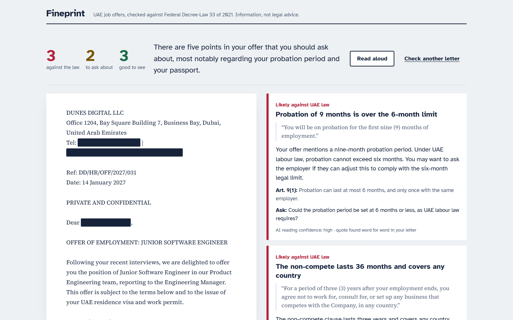
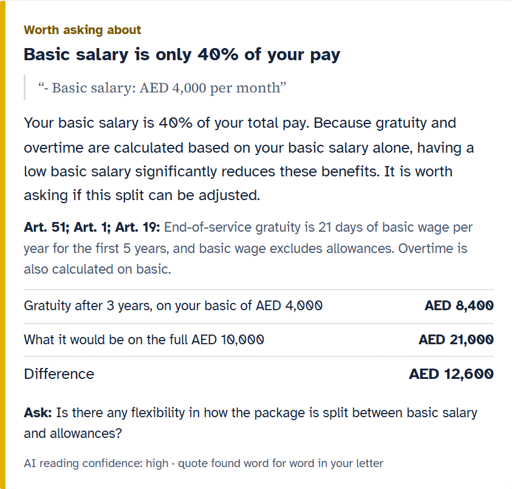
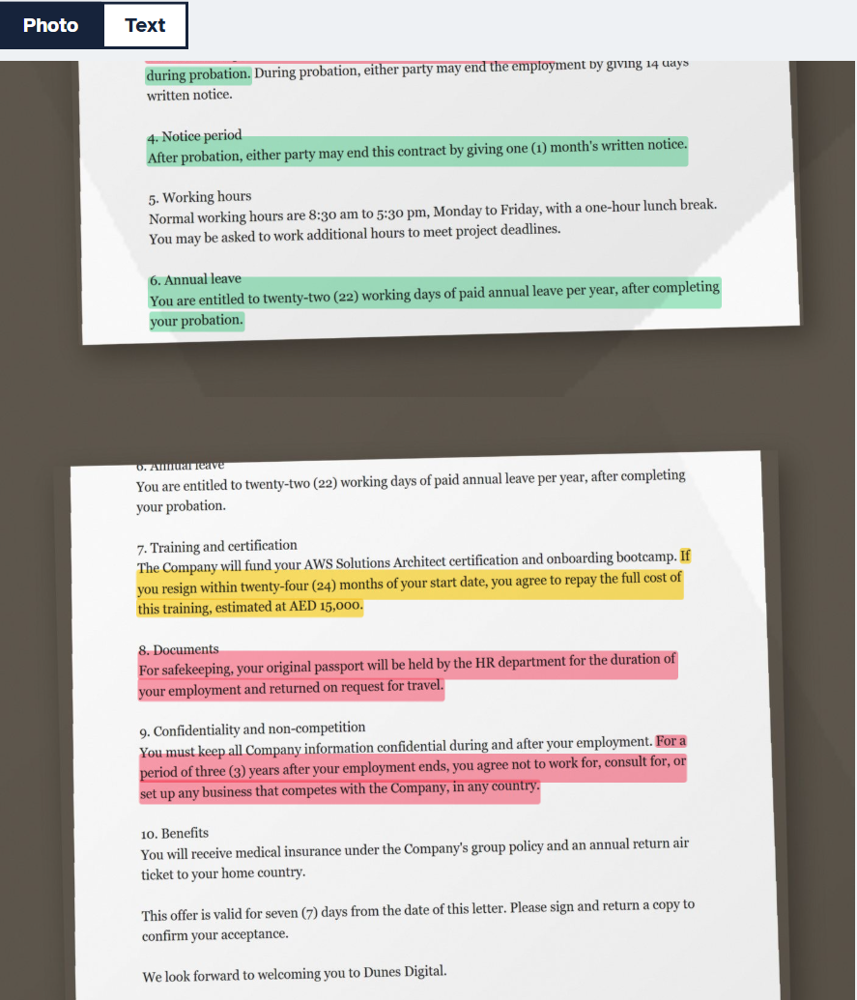

# Fineprint

**Read the fine print before you sign.** Fineprint checks a UAE job offer against UAE labour law. It's built for students and fresh graduates who are about to sign their first contract.

You add the offer letter as a PDF, photos of the pages, or pasted text. Fineprint then:
- highlights the clauses worth asking about
- says what the law says about each one, with the article number
- shows what it means in dirhams
- drafts polite questions for HR



> Information, not legal advice. Fineprint covers private-sector jobs on the UAE mainland under Federal Decree-Law No. 33 of 2021. It does not cover DIFC/ADGM, government jobs or domestic work. English letters only.

## Why

I'm a computer science student in the UAE, and my first offer letters are coming. When I read sample offers, I couldn't tell what was normal. Is a 9-month probation allowed? Why is the "basic salary" only 40% of the package? Can an employer keep my passport "for safekeeping"?

The answers are in the law, but nobody reads a 70-article decree before signing. Fineprint does that part and shows its work.

## What it does

| | |
|---|---|
|  |  |

**Money, not just rules.** End-of-service gratuity is calculated on *basic* salary only (Art. 51). On the sample letter, a "AED 10,000 a month" offer with AED 4,000 basic pays **AED 8,400** of gratuity after 3 years, not AED 21,000. Fineprint shows the gap.

**Highlights on your own photo.** Photograph each page. Fineprint reads the text on your device and highlights the risky clauses on the photo itself: red is likely against the law, amber is worth asking about, green is good to see.

**Questions for HR.** You get a short, polite email that asks about each red and amber point.

## How it works

```
Your device                                     Fineprint server        Gemini
-----------                                     ----------------        ------
PDF   -> pdf.js text            \
photo -> Tesseract OCR (WASM)    } -> blank out personal details -> /api/read ----> 1. READ: terms + exact quotes (JSON)
paste -> text                   /     (names, emails, phones,        (key kept     <----
                                       Emirates ID, passport, IBAN)    here)
2. VERIFY: every quote must appear in your letter, or the term is dropped
3. JUDGE:  13 tested rules (TypeScript, no AI) against Decree-Law 33/2021, with AED maths
           findings only (not the letter) -> /api/explain ---------------------------> 4. EXPLAIN: plain English + HR email
```

- **The AI reads; it never decides.** Gemini extracts the terms, and each one comes with a word-for-word quote and a confidence level. Plain, unit-tested rules make every verdict and cite the article. The explanation step sees only the findings, and its instructions forbid new legal claims.
- **Hallucinated quotes are blocked.** A term is used only if its quote is actually in your letter. Spacing and OCR slips are allowed for. In testing, this check dropped terms the model had invented.
- **Model:** `gemini-3.1-flash-lite`, with `gemini-3-flash-preview` and `gemini-3.5-flash` as fallbacks when it's busy. The output must match a JSON schema.
- **Law sources:** every rule, threshold and article is in [docs/law-notes.md](docs/law-notes.md). They were checked against MOHRE's consolidated English text of Decree-Law 33/2021, including Cabinet Resolution 1/2022 and the amendments. Where the law is silent, Fineprint says "ask", not "illegal". Training bonds are an example.

## Accuracy, measured

The test letters are fictional, with problems planted in them. `npm run eval` runs read → verify → rules against the live model and compares the red and amber findings with the planted list.

| Set | Letters | Runs each | Planted issues found | False alarms |
|---|---|---|---|---|
| Held-out (written and [committed](eval/heldout) before its first run, never tuned on) | 6 | 3 | **33 of 33** | **0** |
| Development (used while building the rules and prompts) | 8 | 2 | 38 of 38 | 0 |

Both sets ran on `gemini-3.1-flash-lite`, with a median of about 2.5 s per read. The raw results are in [eval/results](eval/results).

- Two letters in each set are clean, to measure false alarms.
- In early development runs there were 3 false alarms: the same fee counted twice, and an "unclear contract type". Both were fixed in the rules before the held-out set was written.

**Limits:**
- The letters are synthetic and few (14).
- Real letters will be messier, and photos of crumpled pages will read worse.
- The rules cover 13 topics, not the whole law.

## Privacy

- **Blanked on your device first.** Personal details are blanked out on your device before anything is sent, and you can black out more by hand. Masks keep the text length, so highlights still line up.
- **Photos never leave your device.** Only the blanked-out *text* goes to the server.
- **The explanation step never sees your letter**, only the findings.
- **Nothing is stored.** No accounts, no database, no analytics. The server functions never log letter text.
- **The key stays on the server.** The Gemini key lives only in the server function's secrets. Requests must come from the site itself, and each visitor is rate-limited.

## Run it yourself

You need Node 22+ and a free Gemini API key from Google AI Studio.

```bash
git clone https://github.com/zuhairhalawa/fineprint && cd fineprint
npm install
echo 'GEMINI_API_KEY="your-key"' > .dev.vars
npm run build
npx wrangler pages dev dist      # http://localhost:8788
```

- **Tests:** `npm test` runs 31 unit tests for the rules, gratuity maths, blanking and quote matching.
- **Accuracy:** `npm run eval -- 3 heldout` runs the live accuracy test.
- **Deploy:** `npx wrangler pages deploy dist --project-name fineprint`, then set `GEMINI_API_KEY` as a secret for the Pages project.

## Layout

```
src/redact     on-device blanking of personal details
src/ingest     PDF (pdf.js) and photo (Tesseract) readers
src/read       Gemini prompts and JSON schemas, quote matching, term verification
src/rules      the rule checker (no AI)
src/money      gratuity maths
src/server     guards shared by the server functions
src/ui         the page
functions/api  Cloudflare Pages Functions: /api/read, /api/explain
eval           test letters, accuracy runner, results
docs           design spec, law notes, screenshots
```

## Licence

MIT. The sample company, people and letters are fictional.
